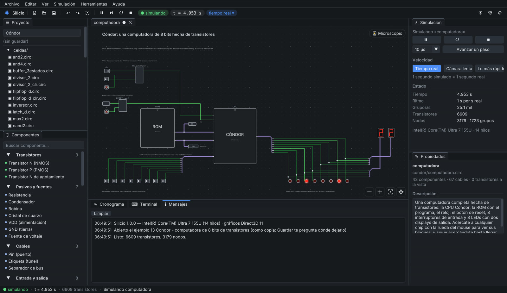
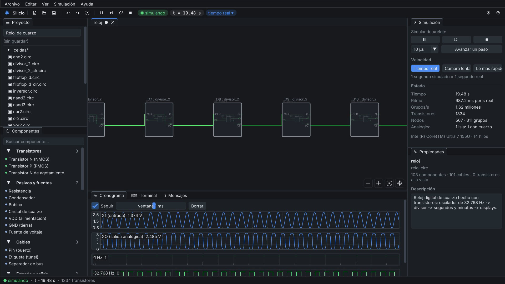
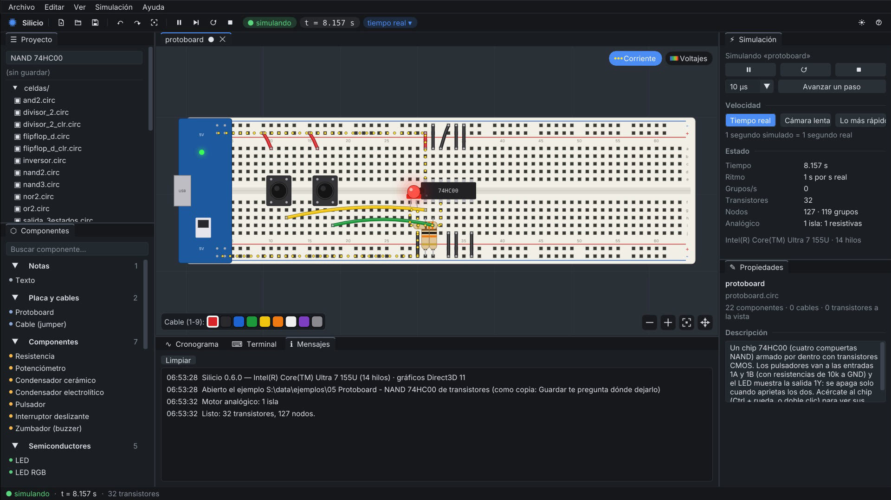
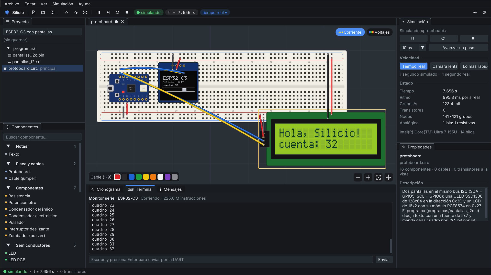
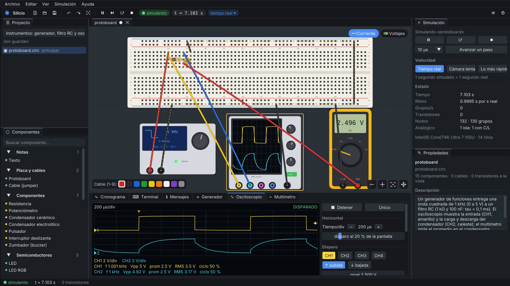
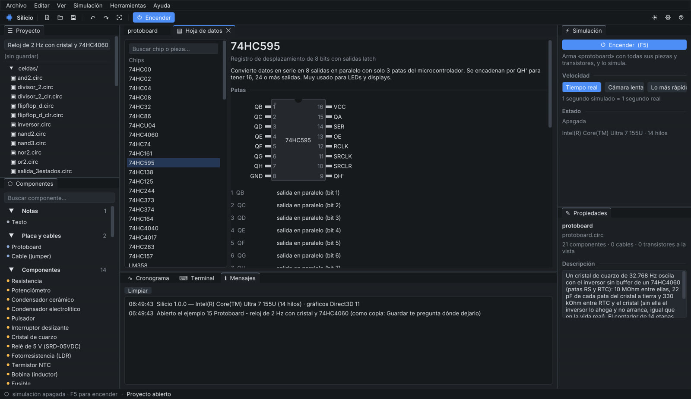

# Silicio

[English](README.md) · **Español**

**Electrónica y computadores, desde el transistor.** Un simulador para Windows donde todo está hecho de transistores que funcionan en vivo, y donde te puedes acercar a cualquier chip hasta verlos conmutar.

▶ **[Ver el video (64 s)](https://github.com/franciscoaldun/silicio/releases/download/v1.0.1/Silicio-video-condor.mp4)** · ⬇ **[Probar gratis](https://github.com/franciscoaldun/silicio/releases/download/v1.0.1/Silicio-1.0.1-prueba.zip)** · 🛒 **[Silicio completo en la Microsoft Store](https://apps.microsoft.com/detail/9PFK8C3LC5NB)**

## Qué es

En Silicio la pieza básica es el transistor. Las compuertas, los flip-flops, los contadores, las memorias y los chips se arman con transistores N y P, y un motor analógico tipo SPICE resuelve LEDs, diodos, transistores, condensadores, bobinas y cristales de cuarzo. Se arma en un esquemático, en una protoboard como la de verdad o en un montaje libre con cables, y con el **zoom infinito** te acercas a cualquier bloque o chip para verlo funcionar por dentro, en el mismo lienzo, sin abrir ventanas.

Está hecho para aprender electricidad, electrónica, sistemas digitales y arquitectura de computadores viendo cómo funciona todo de verdad, desde un LED hasta una computadora completa. Funciona sin internet, en español y en inglés.

## Lo que puedes hacer

### Cóndor: una computadora de 8 bits hecha de transistores
6.609 transistores con su CPU, su ROM, su RAM, el reloj, interruptores y displays, todo unido con cables de verdad. Corre la serie de Fibonacci y otros cuatro programas, y te puedes acercar desde la placa hasta cada transistor mientras funciona.

### Zoom infinito y microscopio
Acércate a un bloque y su circuito aparece adentro, funcionando: del reloj al divisor, del divisor al flip-flop, del flip-flop a la compuerta NAND y de la NAND a sus 4 transistores. Con el **microscopio** cada chip se ve como silicio fabricado, con sus patas, sus anillos de alimentación, sus transistores y tres capas de metal encendidas en vivo, y el botón «Fabricar capa por capa» lo arma paso a paso.

### Una protoboard con chips que se abren
Resistencias con sus bandas de colores, LEDs, pulsadores, potenciómetros, transistores, relés, sensores, motores y **39 chips DIP**: lógica 74HC hecha de transistores CMOS, contadores, registros, el 555, amplificadores operacionales, memorias y relojes I2C. Las piezas se queman como en la vida real, y Silicio te avisa de cortocircuitos, LEDs al revés y patas al aire. Cuando tu montaje funciona, lo llevas a una **placa de circuito impreso en KiCad**.

### ESP32-C3 y Arduino Uno con programas reales
Escribes el programa en C, aprietas F9 y corre en el microcontrolador simulado: un ESP32-C3 (RISC-V) y un Arduino Uno R3 (ATmega328P), con monitor serie. Las pantallas OLED, LCD, TM1637 y MAX7219 y los sensores HC-SR04, DHT22, DS18B20 y DS3231 reciben el protocolo real, bit por bit.

### Instrumentos de laboratorio
Multímetro con modo diodo, osciloscopio de 4 canales con disparo, medidas y FFT, analizador lógico que decodifica I2C, SPI y UART, generador de funciones y fuente con límite de corriente.

### Hojas de datos sin internet, y Verilog
Cada chip y cada pieza explica para qué se usa en la vida real, qué hace cada pata y cómo se conecta. Y si escribes un circuito en Verilog, Silicio lo convierte en compuertas hechas de transistores.

## Probar gratis

- Baja [`Silicio-1.0.1-prueba.zip`](https://github.com/franciscoaldun/silicio/releases/download/v1.0.1/Silicio-1.0.1-prueba.zip), descomprímelo y abre `silicio.exe`. En la versión de prueba funciona todo, pero no se pueden guardar proyectos ni exportarlos.
- **Requisitos:** Windows 10 u 11 de 64 bits, con cualquier procesador x86-64 (también Celeron y Pentium). No necesita internet.
- Windows puede mostrar "Windows protegió su PC" porque el programa es nuevo: "Más información" → "Ejecutar de todas formas".

## Comprar

**Silicio completo** guarda tus proyectos, exporta imágenes y placas de KiCad, y cada compra ayuda a que siga creciendo.

👉 **[Silicio en la Microsoft Store](https://apps.microsoft.com/detail/9PFK8C3LC5NB)**

Desde la versión de prueba también llegas ahí con el botón «Comprar Silicio».

## Para colegios, universidades y empresas

Silicio sirve para clases de electricidad, electrónica, sistemas digitales y arquitectura de computadores, y funciona sin internet en salas de computación. Las instituciones y empresas necesitan una licencia institucional: escribe a **contacto@franciscoaldunate.cl**.

## Licencia

Silicio no es software libre: es un programa con todos los derechos reservados, con una [licencia de uso](LICENCIA.md) que permite usarlo para aprender, estudiar y hacer tus propios proyectos. Lo que creas con Silicio es tuyo. Los componentes de terceros mantienen sus licencias ([TERCEROS.md](TERCEROS.md)). Silicio no recopila datos ([PRIVACIDAD.md](PRIVACIDAD.md)).

## Versiones

| Versión | Fecha | Archivo | SHA-256 |
|---|---|---|---|
| 1.0.1 | 10-11-2026 | `Silicio-1.0.1.msix` (completa, en la Microsoft Store) | `851072fab8eaee1ec8c7c453be52d5228f7edd0cf361be1b3b6f352f5c427cba` |
| 1.0.1 | 11-11-2026 | `Silicio-1.0.1-prueba.zip` (prueba) | `f3babfad58d1fe413386aa85ce0b1d842ecc82bd598303fd1bdda2d46edea8da` |
| 0.6.1 | 18-10-2026 | `Silicio-0.6.1-portable.zip` (primera edición pública) | `36c89bb2b099ccfecb7f0a4fe93e2aeaab3d149166abd6f62a28e85d55895815` |

Descripción técnica y constancia con fecha en Zenodo: versión 1.0.1, [10.5281/zenodo.24134452](https://doi.org/10.5281/zenodo.24134452); versión 0.6.1, [10.5281/zenodo.23460025](https://doi.org/10.5281/zenodo.23460025).

Los cambios de cada versión están en [CAMBIOS.md](CAMBIOS.md).

---

Desarrollado por Francisco Aldunate · [contacto@franciscoaldunate.cl](mailto:contacto@franciscoaldunate.cl)
