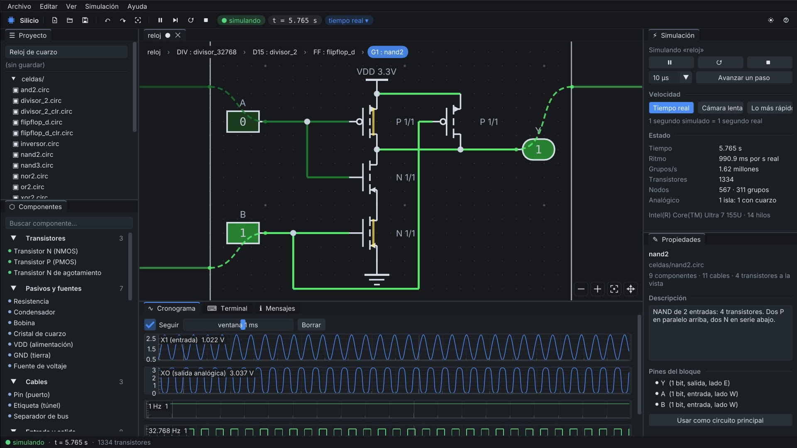
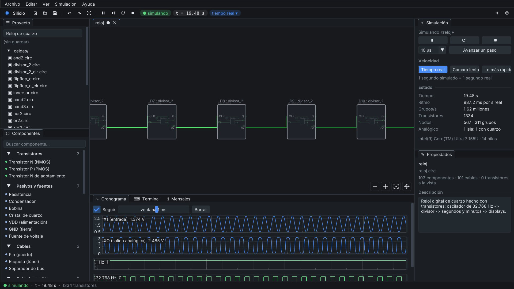
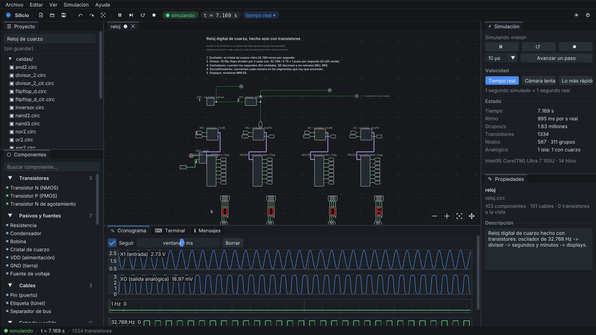
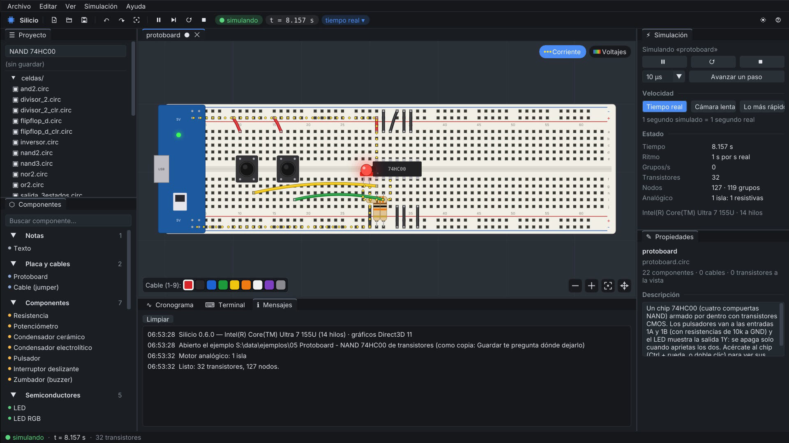
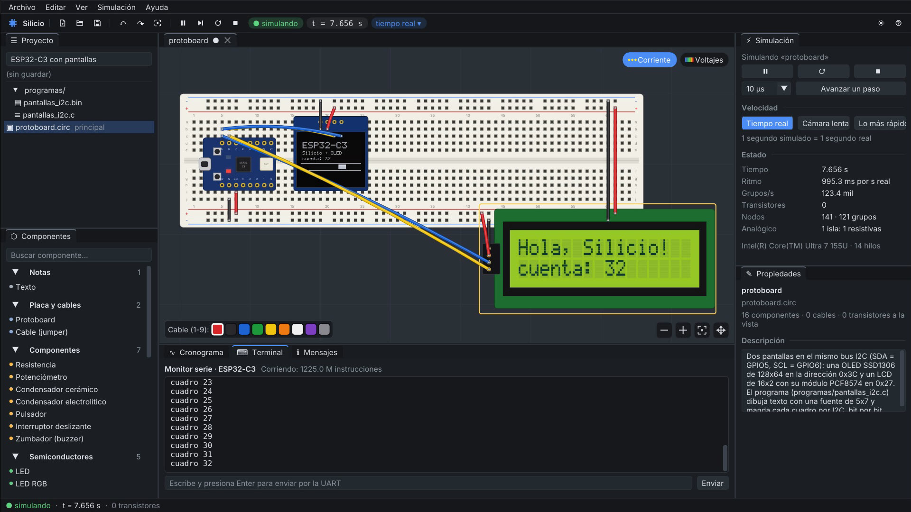
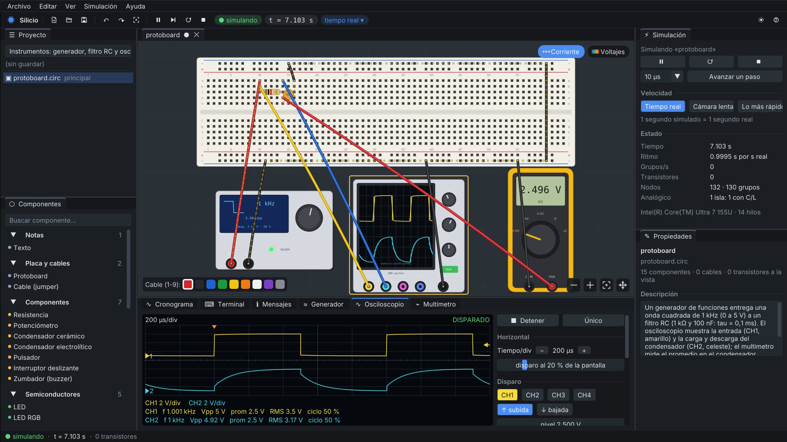

# Silicio

**Electrónica y computadores, desde el transistor.** Un simulador para Windows donde todo está hecho de transistores que funcionan en vivo, y donde te puedes acercar a cualquier chip hasta verlos conmutar.

▶ **[Ver el video (46 s)](https://github.com/franciscoaldun/silicio/releases/download/v0.6.1/Silicio-video-demo.mp4)** · ⬇ **[Probar gratis](https://github.com/franciscoaldun/silicio/releases/download/v0.6.1/Silicio-0.6.1-prueba.zip)** · 🛒 **[Comprar Silicio](#comprar)**

## Qué es

En Silicio la pieza básica es el transistor. Las compuertas, los flip-flops, los contadores y los chips se arman con transistores N y P, y un motor analógico tipo SPICE resuelve LEDs, diodos, condensadores, bobinas y cristales de cuarzo. Se arma en un esquemático o en una protoboard como la de verdad, y con el **zoom infinito** te acercas a cualquier bloque o chip para verlo funcionar por dentro, en el mismo lienzo, sin abrir ventanas.

Está hecho para aprender electricidad, electrónica y arquitectura de computadores viendo cómo funciona todo de verdad, desde un LED hasta un chip.

## Lo que puedes hacer

### Zoom infinito, sin ventanas
Acércate a un bloque y su circuito aparece adentro, funcionando: del reloj al divisor, del divisor al flip-flop, del flip-flop a la compuerta NAND y de la NAND a sus 4 transistores. Los cables te siguen entre los niveles, así nunca pierdes adónde va cada señal.

### Un reloj de cuarzo hecho solo con transistores
Un cristal de 32.768 Hz simulado de verdad (arranca solo, desde el ruido), un divisor de 15 flip-flops y contadores que muestran MM:SS. Son 1.334 transistores y corre en tiempo real.

### Una protoboard con chips que se abren
Resistencias con sus bandas de colores, LEDs, pulsadores, potenciómetros, transistores, pilas y chips 74HC (00, 02, 04, 08, 32, 86, 74, 161 y 595) hechos de transistores CMOS. Las piezas se queman como en la vida real, y Silicio te avisa de cortocircuitos, LEDs al revés y patas al aire.

### Un ESP32-C3 que corre programas reales
La placa ESP32-C3 SuperMini ejecuta programas RISC-V reales, con GPIO, UART, PWM, I2C, SPI e interrupciones, y maneja pantallas OLED SSD1306, LCD 16x2, TM1637 y matrices MAX7219, que reciben el protocolo real bit por bit.

### Instrumentos de laboratorio
Multímetro, osciloscopio de 4 canales con disparo, medidas y FFT, analizador lógico que decodifica I2C, SPI y UART, generador de funciones y fuente con límite de corriente.

## Probar gratis

- Baja [`Silicio-0.6.1-prueba.zip`](https://github.com/franciscoaldun/silicio/releases/download/v0.6.1/Silicio-0.6.1-prueba.zip), descomprímelo y abre `silicio.exe`. En la versión de prueba funciona todo, pero no se pueden guardar proyectos.
- **Requisitos:** Windows 10 u 11 de 64 bits, con cualquier procesador x86-64 (también Celeron y Pentium). No necesita internet.
- Windows puede mostrar "Windows protegió su PC" porque el programa es nuevo: "Más información" → "Ejecutar de todas formas".

## Comprar

**Silicio completo** guarda tus proyectos, y cada compra ayuda a que siga creciendo.

- **Microsoft Store:** muy pronto.
- **itch.io:** muy pronto.

## Para colegios, universidades y empresas

Silicio sirve para clases de electricidad, electrónica, sistemas digitales y arquitectura de computadores, y funciona sin internet en salas de computación. Las instituciones y empresas necesitan una licencia institucional: escribe a **contacto@franciscoaldunate.cl**.

## Licencia

Silicio no es software libre: es un programa con todos los derechos reservados, con una [licencia de uso](LICENCIA.md) que permite usarlo para aprender, estudiar y hacer tus propios proyectos. Lo que creas con Silicio es tuyo. Los componentes de terceros mantienen sus licencias ([TERCEROS.md](TERCEROS.md)). Silicio no recopila datos ([PRIVACIDAD.md](PRIVACIDAD.md)).

## Versiones

| Versión | Fecha | Archivo | SHA-256 |
|---|---|---|---|
| 0.6.1 | 18-10-2026 | `Silicio-0.6.1-portable.zip` (completa, se vende aparte) | `36c89bb2b099ccfecb7f0a4fe93e2aeaab3d149166abd6f62a28e85d55895815` |
| 0.6.1 | 18-10-2026 | `Silicio-0.6.1-prueba.zip` (prueba) | `56057f50a760218974dec20fc60caef420293fa9817ac251d109cf17bb99d326` |

Descripción técnica y constancia con fecha en Zenodo: [10.5281/zenodo.23460025](https://doi.org/10.5281/zenodo.23460025).

Los cambios de cada versión están en [CAMBIOS.md](CAMBIOS.md).

## English

**Silicio** is a Windows simulator for electronics and computers built from the transistor up. Gates, flip-flops, counters and chips are made of N and P transistors running live, with a SPICE-like analog engine for LEDs, capacitors, inductors and quartz crystals. An **infinite-zoom map** lets you dive into any block or chip, down to its switching transistors, without opening windows. It includes a breadboard with 74HC chips made of CMOS transistors, an ESP32-C3 that runs real RISC-V firmware with OLED/LCD displays, and lab instruments (multimeter, 4-channel oscilloscope with FFT, logic analyzer with I2C/SPI/UART decoding, function generator and current-limited power supply). The interface is in Spanish for now. Schools and companies: contacto@franciscoaldunate.cl.

---

Desarrollado por Francisco Aldunate · [contacto@franciscoaldunate.cl](mailto:contacto@franciscoaldunate.cl)
